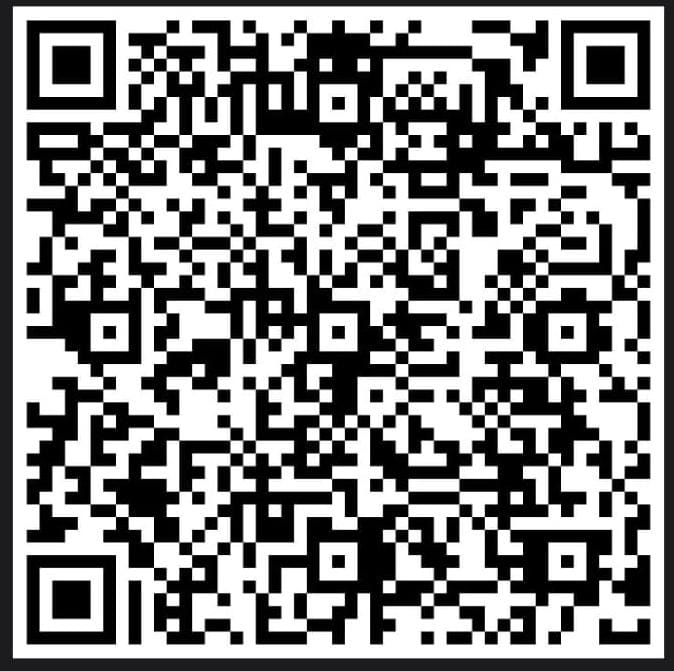

# Tutoriais de TI | Infraestrutura, Redes e Sistemas

Repositório dedicado à documentação técnica, ao compartilhamento de conhecimento e à organização de procedimentos práticos relacionados à **infraestrutura de TI, administração de sistemas, redes corporativas e segurança da informação**.

O objetivo é reunir tutoriais, guias de implementação, configurações e procedimentos técnicos desenvolvidos a partir de estudos, testes em laboratório e experiências práticas com tecnologias utilizadas em ambientes domésticos, corporativos e de pequenas e médias empresas.

## Sobre o projeto

A administração de uma infraestrutura de TI exige planejamento, documentação, padronização e conhecimento técnico. Este repositório foi criado para centralizar procedimentos que facilitem a implantação, a manutenção, o diagnóstico e a evolução de ambientes de tecnologia da informação.

O conteúdo é voltado a profissionais de TI, administradores de sistemas, técnicos de suporte, estudantes e entusiastas que buscam referências práticas para suas atividades.

## Áreas de conhecimento

### Linux e administração de sistemas
- Instalação, configuração e manutenção de distribuições Linux.
- Administração de usuários, permissões e serviços.
- Integração de estações Linux a domínios Active Directory.
- Autenticação centralizada e gerenciamento de ambientes corporativos.
- Serviços de arquivos e compartilhamento com Samba.

### Redes e infraestrutura
- Configuração e administração de redes locais (LAN).
- Roteamento, segmentação de redes, VLANs e VPNs.
- Administração de equipamentos MikroTik, Ubiquiti, Grandstream, TP-Link Omada, Cisco entre outros.
- Infraestrutura de redes cabeadas e sem fio.
- Diagnóstico de conectividade e resolução de problemas.

### Servidores e virtualização
- Implantação e administração de servidores Linux.
- Ambientes virtualizados com Proxmox VE.
- Serviços de diretório, DNS, DHCP e compartilhamento de arquivos.
- Estruturação de infraestrutura para pequenas e médias empresas.
- Laboratórios para validação de configurações e novas tecnologias.

### Monitoramento e observabilidade
- Monitoramento de disponibilidade e desempenho com Zabbix.
- Visualização de métricas e indicadores com Grafana.
- Inventário de ativos e organização de informações técnicas.
- Acompanhamento de serviços, equipamentos e infraestrutura.

### Segurança e continuidade operacional
- Boas práticas de segurança em redes e sistemas.
- Acesso remoto seguro e conectividade entre unidades.
- Estratégias de backup e recuperação de dados.
- Monitoramento de serviços e identificação de falhas.
- Documentação de procedimentos de manutenção e contingência.

### Suporte técnico e manutenção
- Diagnóstico e manutenção de computadores e notebooks.
- Instalação e configuração de sistemas operacionais.
- Resolução de problemas de hardware e software.
- Padronização de ambientes de trabalho.
- Ferramentas de suporte remoto e administração de estações.

## Organização do conteúdo

Os tutoriais são organizados por categoria e tecnologia, com o objetivo de facilitar a consulta, a reutilização de procedimentos e a manutenção da documentação.

Sempre que aplicável, os materiais incluem:

- Pré-requisitos e contexto de aplicação.
- Comandos e arquivos de configuração.
- Procedimentos apresentados em etapas.
- Exemplos práticos de utilização.
- Verificações para validar o funcionamento.
- Observações e recomendações técnicas.

## Filosofia de documentação

A proposta é priorizar documentação clara, objetiva e reproduzível, valorizando soluções que possam ser compreendidas, verificadas e adaptadas às necessidades de cada ambiente.

Os procedimentos publicados servem como referência técnica e devem ser avaliados antes da aplicação em produção, considerando versões de software, particularidades da infraestrutura, requisitos de segurança e políticas de cada organização.

## Tecnologias e ferramentas

Entre as tecnologias abordadas ou exploradas neste projeto estão:

**Sistemas operacionais:** Debian, Ubuntu, Linux Mint e Windows Server.

**Redes:** MikroTik RouterOS, Ubiquiti UniFi, TP-Link Omada e Grandstream.

**Servidores e virtualização:** Samba, Active Directory, Univention Corporate Server (UCS) e Proxmox VE.

**Monitoramento e gestão:** Zabbix, Grafana, Dolibarr.

**Backup e armazenamento:** soluções de backup local e em nuvem, armazenamento em rede e estratégias de recuperação de dados.

A lista poderá ser ampliada conforme novos estudos, projetos e procedimentos forem documentados.

## Contribuição e compartilhamento

Este repositório tem como propósito contribuir para a disseminação de conhecimento técnico e incentivar a documentação de soluções aplicáveis ao cotidiano da infraestrutura de TI.

Sugestões, correções e contribuições são bem-vindas, especialmente aquelas que aumentem a clareza, a segurança, a precisão técnica e a aplicabilidade dos procedimentos.

## 🍕 Este conteúdo te ajudou a sair do sufoco?

Se algum tutorial deste repositório te salvou horas de pesquisa, resolveu aquele problema complicado ou te ajudou a colocar a infraestrutura de pé, considere deixar uma pizza como forma de agradecimento! 😄

**É só apontar a câmera para o QR Code abaixo e contribuir.**

  

  <em>Obrigado por valorizar e apoiar o compartilhamento de conhecimento técnico!</em> ❤️

---

**Documentação técnica • Infraestrutura de TI • Redes • Sistemas • Segurança • Conhecimento compartilhado**
